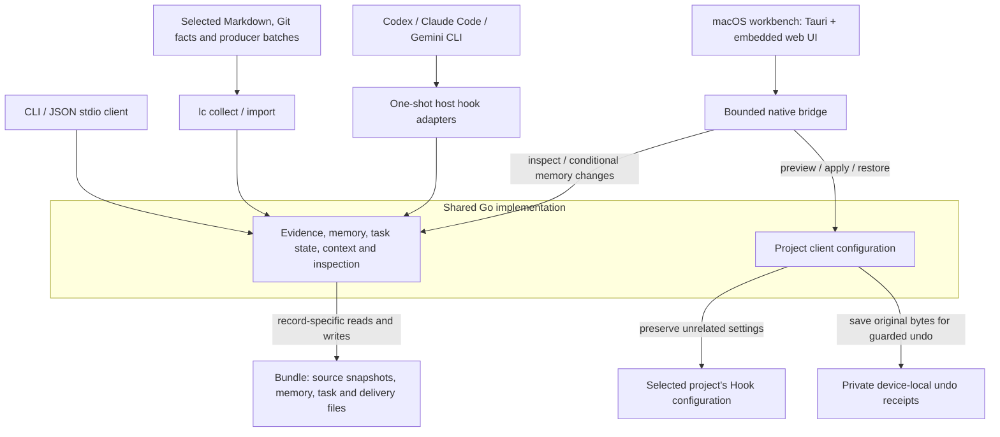
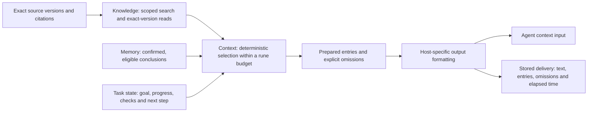

# Product architecture

LiteContext is one local product with a shared Go implementation. The macOS workbench provides observation and explicit management; host adapters provide context during an agent session. CLI commands remain the executable integration surface. The diagrams describe implemented responsibilities, not separate deployed services.

## Entry points and persistence

The arrows show requests and storage ownership. Results return through the calling interface. A Hook formats the selected context for its host; the workbench displays stored reports. Neither the webview nor the host adapter owns a second information store.

Project configuration and undo receipts stay outside the bundle. `lc client-config` reuses host profile generation and validates the selected bundle, but does not launch the host, grant trust or prove that a Hook was loaded.

## Information supplied to a task

Knowledge and Memory are peer suppliers to Context; they are not stages of a single conversion pipeline. Memory records retain evidence references, including references outside the bundle; references alone do not prove their contents or execution of a check. A task checkpoint is not promoted to memory automatically. Candidate memories are excluded until confirmation. Revocation and supersession immediately remove the old memory from selection; a replacement still needs confirmation.

The `prepare` operation is also available directly through the session contract without a Hook. Selection uses a rendered-text rune budget, not a model tokenizer. Stored delivery records describe emitted output; host acknowledgement and actual use remain unknown. A failed delivery-record write does not prevent a Hook from returning its context.

## Implementation map

| Responsibility | Current implementation | Boundary |
| --- | --- | --- |
| Evidence and Knowledge | `internal/contextmodel`, `internal/bundle`, `internal/ingest` | Exact versions, source scope, visibility and read-only source collection |
| Memory, task, Context and inspection | `internal/session` | Eight versioned session operations; distinct record types and locks |
| Host adaptation | `internal/host` | Codex and Claude event profiles; Gemini `BeforeAgent` only |
| Client configuration | `internal/clientconfig` | Project files only; preview fingerprints, conflict checks and local undo |
| Desktop management | `desktop` | Five narrow native commands, packaged Go executable, no frontend filesystem access |
| Scriptable entry and static report | `cmd/litecontext`, `internal/view` | CLI, JSON stdio, and a read-only exported HTML report |

The bundle is authoritative for information records, but it is not one transaction spanning every record type. Source snapshots commit through an atomic `HEAD` replacement. Memory, task, event and delivery files have their own update rules. Memory supersession is not crash-atomic across both records. Device-local client configuration has a separate fingerprint and undo lifecycle.

## Current operating boundary

- One foreground desktop window and one-shot Hook processes; no machine-wide daemon or network listener.
- The desktop uses Tauri/Rust for its native boundary and invokes the packaged Go core with fixed arguments and bounded JSON input/output. No model call is required for retrieval or context delivery.
- macOS is the desktop validation target. Go CI covers macOS, Linux and Windows; Windows desktop operation and Windows agent Hook loading remain unverified.
- Written client configuration is observable; successful loading, host trust and actual use require evidence from that client.
- Automatic history scanning, model-driven memory extraction, a vector database and a knowledge graph are not implemented. JSON stdio is the current session interface; it must not be labelled as an implemented MCP server.

See [Information layer](information-layer.md) for contract semantics, [Evidence storage](overview.md) for snapshot behavior, [Desktop workbench](desktop-workbench.md) for native process limits, and [Client configuration](client-configuration.md) for apply/undo behavior.
